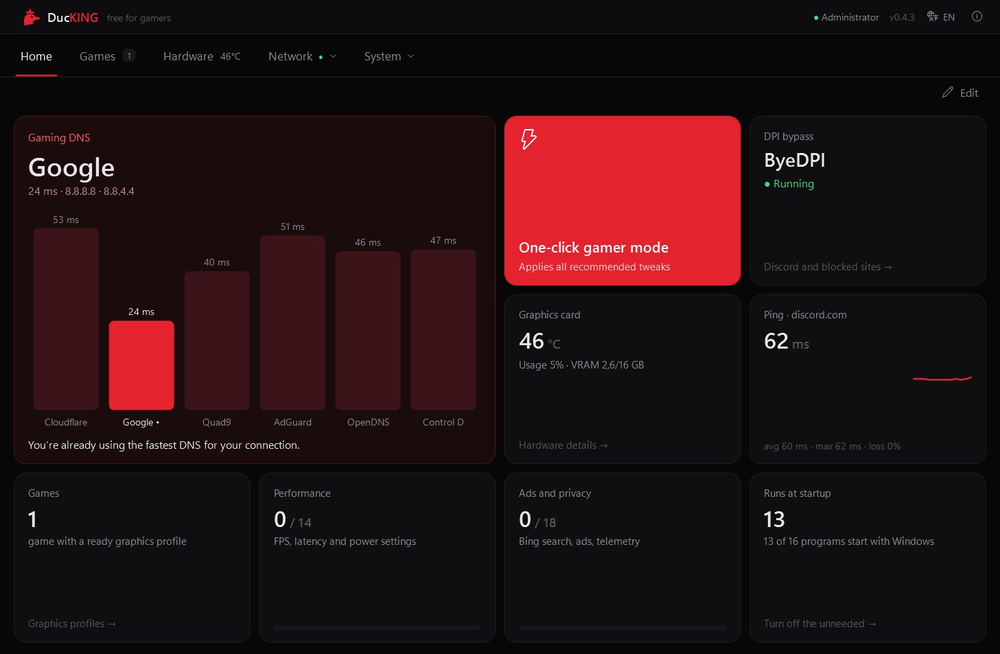
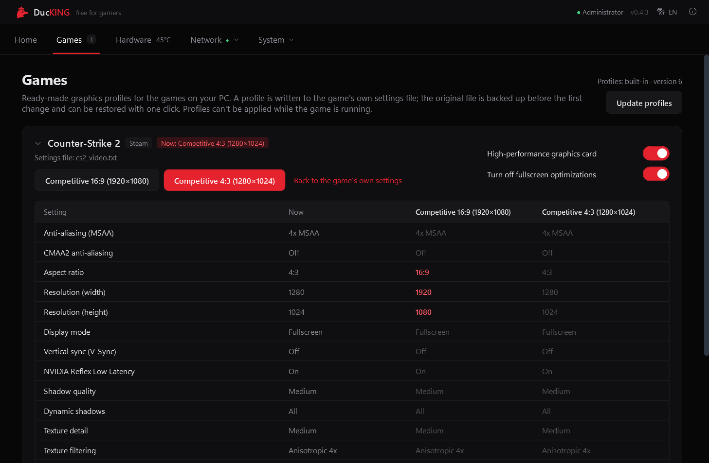
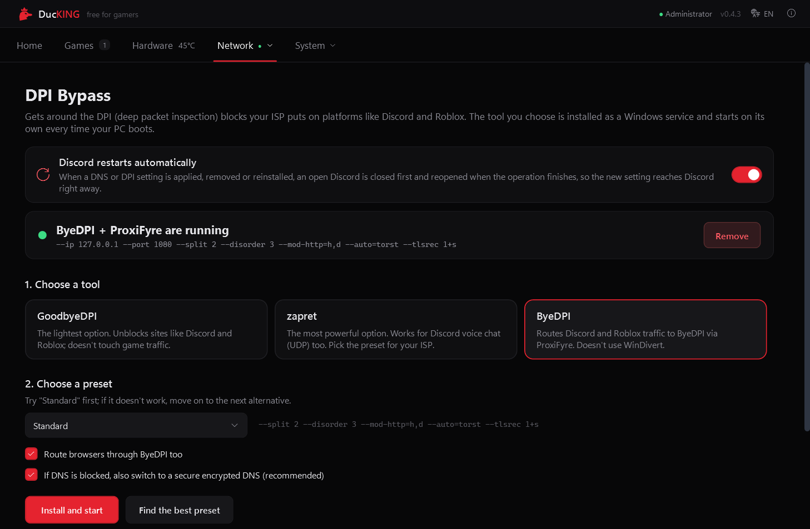
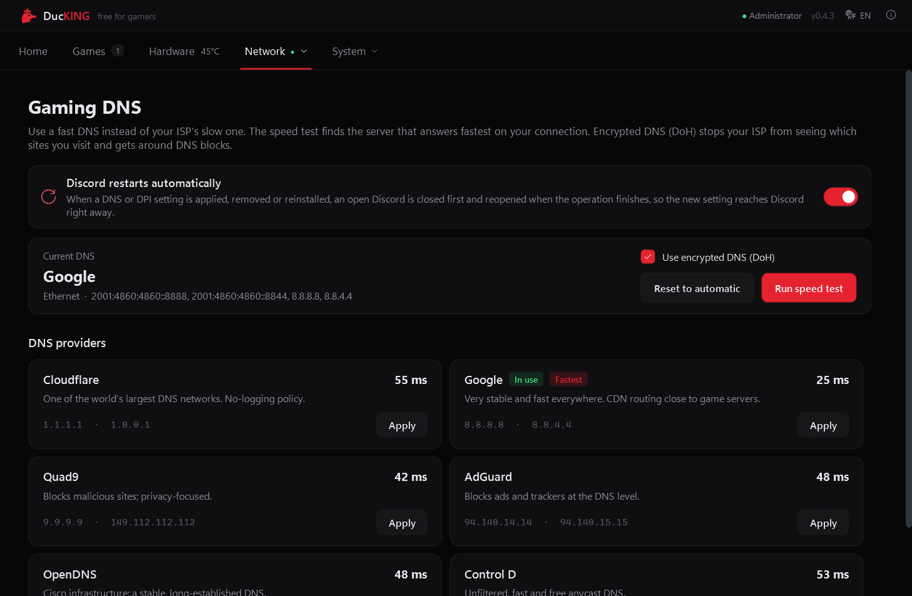
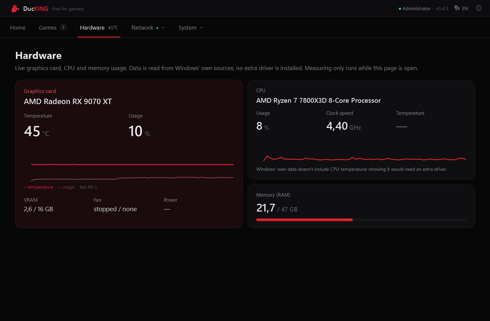
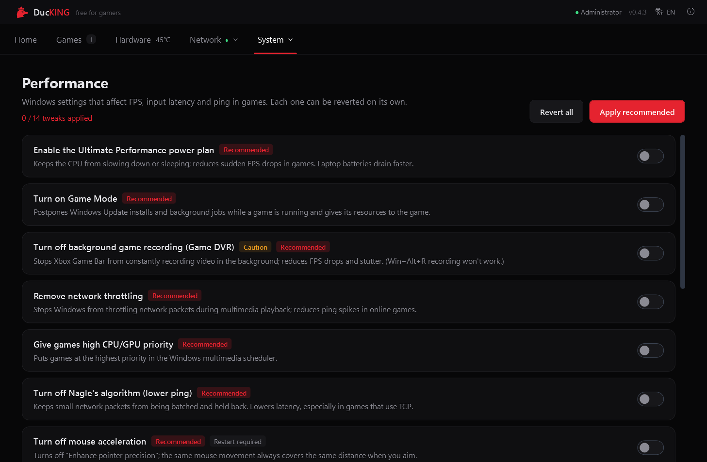

<p align="center">
  
</p>

<h1 align="center">DucKING</h1>

<p align="center">
  <b>A free, open-source Windows tool for gamers</b><br>
  Gaming DNS · DPI bypass · ads and telemetry off · performance tweaks · game graphics profiles
</p>

<p align="center">
  <a href="https://github.com/uy4r/DucKING/releases/latest"></a>
  <a href="https://github.com/uy4r/DucKING/releases"></a>
  
  <a href="LICENSE"></a>
</p>

<p align="center">
  <a href="README.md">Türkçe</a> · <b>English</b> · <a href="README.ru.md">Русский</a>
</p>

<p align="center">
  
</p>

DucKING puts the things a gamer otherwise fixes one by one in Windows into a single program: it finds
the fastest DNS and sets it up encrypted, gets around the DPI blocks ISPs put on platforms like
Discord and Roblox, turns off Windows ads, web search and telemetry, and applies the settings that
affect FPS and latency in games. Every change it makes can be undone with one click.

The interface is available in **Turkish, English and Russian**. You pick the language in the installer
and can change it later from the app's top bar.

## Download

**[Download the latest release](https://github.com/uy4r/DucKING/releases/latest)** → `DucKING-Setup-<version>.exe`

1. Run the installer and pick a language (Türkçe / English / Русский).
2. The file isn't code-signed, so Windows SmartScreen may warn you: **More info → Run anyway**.
3. DucKING runs as administrator; it needs that for DNS, Windows services and system settings.

**Requirements:** 64-bit Windows 10 (1809 or later) or Windows 11. Encrypted DNS (DoH) needs Windows 11.
You don't need to install .NET; the app ships with its own runtime.

## What it does

| | |
| --- | --- |
| **Home** | Tiles you can move and resize to 1×1, 2×1 or 2×2: DNS speeds, DPI status, live ping, GPU temperature, one-click gamer mode. |
| **Gaming DNS** | Measures 6 providers (Cloudflare, Google, Quad9, AdGuard, OpenDNS, Control D) with real DNS queries, sets the fastest one for your connection with one click and turns on encrypted DNS (DoH) on Windows 11. Warns you if your ISP's DNS returns a fake address for Discord. |
| **DPI bypass** | Installs GoodbyeDPI, zapret or ByeDPI (with ProxiFyre) as a Windows service that starts with your PC. Includes presets for Turkish ISPs and for Russia. **Find the best preset** tries the presets one by one and installs the one that opens Discord, YouTube and Roblox best. |
| **Games** | Finds your games in Steam, Epic and Riot libraries and writes ready-made graphics profiles into the game's own settings file, backing up the original first. Click a card to see a table of every setting (anti-aliasing, shadows, textures…) with its current and profile value. |
| **Hardware** | GPU temperature, usage and VRAM, CPU usage and clock speed, memory. No extra driver; it reads Windows' own data. |
| **Performance** | Ultimate Performance power plan, Game Mode, background game recording (Game DVR), network throttling, Nagle's algorithm, mouse acceleration, HAGS and more. |
| **Ads and privacy** | Bing search in the Start menu, ads and suggestions, Copilot, Recall, Widgets and telemetry. |
| **Startup and apps** | Turns off startup programs the same way Task Manager does, and removes preinstalled apps like News, Clipchamp and Teams (Xbox apps are left alone). |
| **Discord restart** | When a DNS or DPI setting changes, an open Discord is closed and reopened afterwards so the new setting takes effect right away. |

## Screenshots

| Games | DPI bypass |
| --- | --- |
|  |  |
| **Gaming DNS** | **Hardware** |
|  |  |
| **Performance** | |
|  | |

## Is it safe?

- **Every setting can be reverted.** The original of every changed value is kept in
  `C:\ProgramData\DucKING\backup.json` and restored when you turn the setting off. One-click gamer mode
  can create a system restore point first.
- **Clean uninstall.** Uninstalling removes the DPI services, ProxiFyre and the firewall rule, and can
  also restore every setting DucKING changed.
- **No data collection.** DucKING has no telemetry or analytics. It only goes online for: the DNS
  speed test, pinging discord.com, the DNS block check, checking GitHub for a new release and profile
  files (it only notifies you and never installs anything by itself), and checking whether sites open
  during "Find the best preset".
- **Antivirus warnings.** GoodbyeDPI and zapret use the WinDivert driver to process packets, which some
  antivirus programs wrongly flag as a threat. All bundled tools are open source and listed below.

If something goes wrong, **About → Create diagnostics report** saves a zip to your desktop (your user
name and computer name are hidden). You can attach it when you
[report an issue](https://github.com/uy4r/DucKING/issues).

## About DPI bypass

| Tool | How it works | When to use it |
| --- | --- | --- |
| **GoodbyeDPI** | Splits outgoing packets with WinDivert and redirects DNS queries to a safe server. | The lightest option; enough in most cases. |
| **zapret** | Sends fake packets with WinDivert; works for Discord voice chat (UDP) too. | Pick the preset for your ISP. |
| **ByeDPI** | A local SOCKS5 proxy; Discord and Roblox traffic is routed to it with ProxiFyre. Doesn't use WinDivert. | Systems where WinDivert doesn't work or antivirus blocks it. |

Only one tool runs at a time. Some ISPs block at the DNS level too; if DucKING detects that, it offers
to switch to encrypted DNS. These tools are meant to get around ISP access blocks; following the laws
of your country is your responsibility.

## Game profiles

Right now **Counter-Strike 2** has two profiles: *Competitive 16:9 (1920×1080)* and *Competitive 4:3
(1280×1024)*. The game list is [`src/DucKING/Profiles/games.json`](src/DucKING/Profiles/games.json)
and is only edited in this repository; users can't add games in the app. When this file's `version`
goes up, DucKING picks up the new profiles from GitHub without waiting for a new release.

To suggest a game, open an [issue](https://github.com/uy4r/DucKING/issues).

## Building from source

You need the [.NET 8 SDK](https://dotnet.microsoft.com/download/dotnet/8.0) and
[Inno Setup 6](https://jrsoftware.org/isinfo.php) (`winget install JRSoftware.InnoSetup`).

```powershell
powershell -File build.ps1
```

The installer is written to `artifacts\DucKING-Setup-<version>.exe`. The version number comes from
`<Version>` in `src/DucKING/DucKING.csproj`. The app icon is generated from
`src/DucKING/Assets/ducking.svg` by `tools\make-icon.ps1`.

```
src/DucKING/
  Core/              Tweak engine, backups, service API, localization (Loc, UiText)
  Modules/Dns/       DNS providers, speed test, DoH
  Modules/Dpi/       GoodbyeDPI, zapret, ByeDPI + ProxiFyre setup and presets
  Modules/Games/     Game detection and graphics profiles
  Modules/Tweaks/    Performance and privacy tweaks
  Profiles/          games.json and dpi-presets.json (embedded in the exe)
  Views/             Pages
  Tools/             Bundled DPI tools
installer/           Inno Setup script
```

## Credits and license

DucKING exists thanks to these open-source projects:
[GoodbyeDPI](https://github.com/ValdikSS/GoodbyeDPI),
[zapret](https://github.com/bol-van/zapret),
[ByeDPI](https://github.com/hufrea/byedpi),
[WinDivert](https://github.com/basil00/WinDivert),
[ProxiFyre](https://github.com/wiresock/proxifyre) and
[Windows Packet Filter](https://github.com/wiresock/ndisapi).
Their licenses and details: [THIRD_PARTY_NOTICES.md](THIRD_PARTY_NOTICES.md).

DucKING's own code is released under the [MIT license](LICENSE). It's free and will stay that way.
