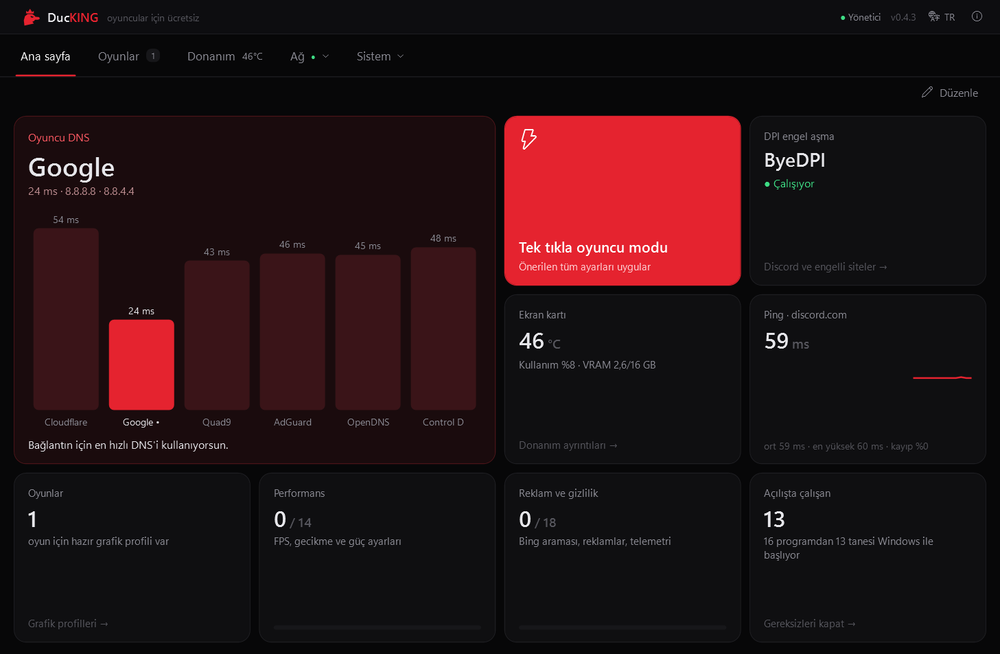
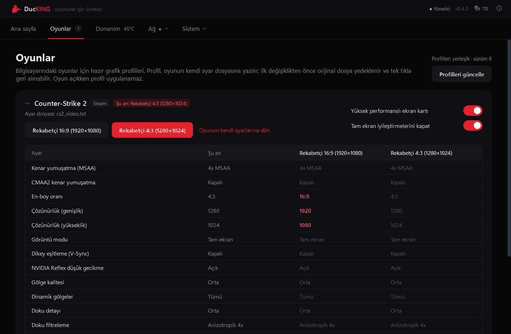
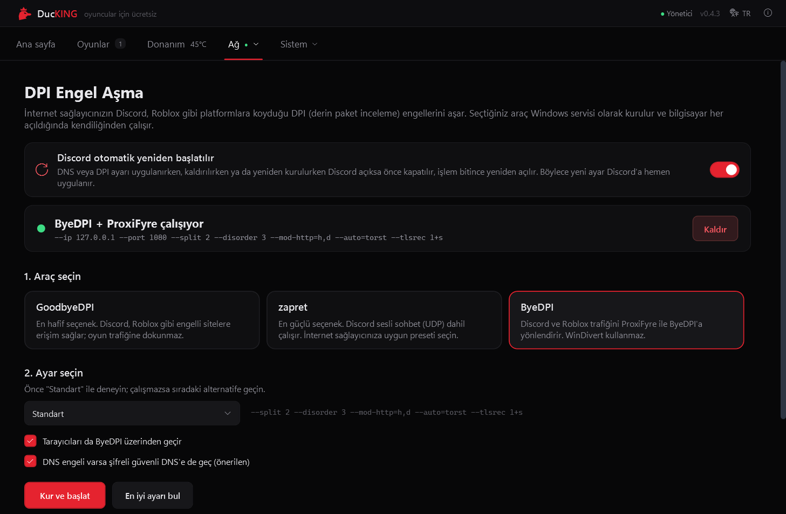
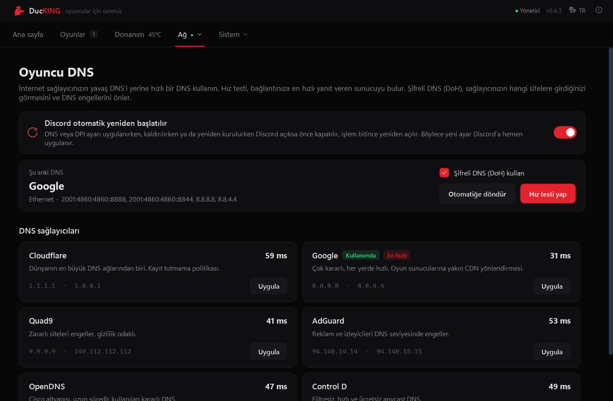
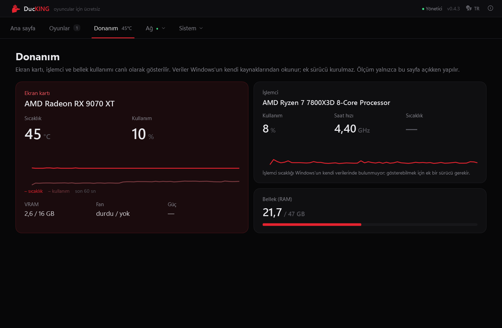
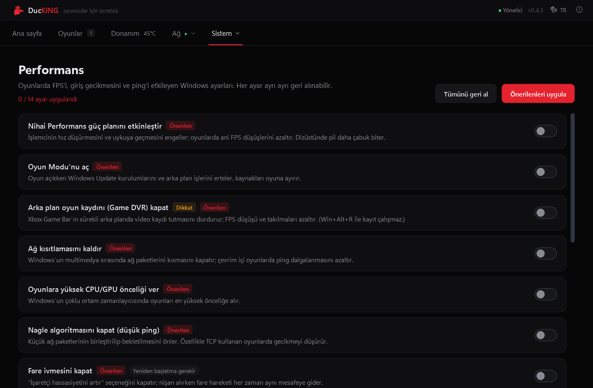

<p align="center">
  
</p>

<h1 align="center">DucKING</h1>

<p align="center">
  <b>Oyuncular için ücretsiz ve açık kaynak Windows aracı</b><br>
  Oyuncu DNS'i · DPI engel aşma · reklam ve telemetri kapatma · performans ayarları · oyun grafik profilleri
</p>

<p align="center">
  <a href="https://github.com/uy4r/DucKING/releases/latest"></a>
  <a href="https://github.com/uy4r/DucKING/releases"></a>
  
  <a href="LICENSE"></a>
</p>

<p align="center">
  <b>Türkçe</b> · <a href="README.en.md">English</a> · <a href="README.ru.md">Русский</a>
</p>

<p align="center">
  
</p>

DucKING, bir oyuncunun Windows'ta tek tek uğraştığı işleri tek programda toplar: en hızlı DNS'i bulup
şifreli olarak ayarlar, internet sağlayıcısının Discord ve Roblox gibi platformlara koyduğu DPI
engellerini aşar, Windows'un reklamlarını, internet aramalarını ve telemetrisini kapatır, oyunlarda FPS
ve gecikmeyi etkileyen ayarları yapar. Yaptığı her değişiklik tek tıkla geri alınabilir.

Arayüz **Türkçe, İngilizce ve Rusça**dır; dil kurulumda seçilir ve sonradan programın üst çubuğundan
değiştirilebilir.

## İndir

**[Son sürümü indir](https://github.com/uy4r/DucKING/releases/latest)** → `DucKING-Setup-<sürüm>.exe`

1. Kurulum dosyasını çalıştırın ve dili seçin (Türkçe / English / Русский).
2. Dosya imzasız olduğu için Windows SmartScreen uyarı gösterebilir: **Ek bilgi → Yine de çalıştır**.
3. DucKING yönetici izniyle çalışır; DNS, Windows servisleri ve sistem ayarları için gereklidir.

**Gereksinimler:** 64 bit Windows 10 (1809 ve üstü) veya Windows 11. Şifreli DNS (DoH) için Windows 11
gerekir. .NET kurmanız gerekmez, program kendi çalışma zamanıyla gelir.

## Neler yapar?

| | |
| --- | --- |
| **Ana sayfa** | Taşınabilen ve 1×1, 2×1, 2×2 boyutlarına getirilebilen kutular: DNS hızları, DPI durumu, canlı ping, ekran kartı sıcaklığı, tek tıkla oyuncu modu. |
| **Oyuncu DNS** | 6 sağlayıcıyı (Cloudflare, Google, Quad9, AdGuard, OpenDNS, Control D) gerçek DNS sorgusuyla ölçer, bağlantınıza en hızlısını tek tıkla ayarlar, Windows 11'de şifreli DNS'i (DoH) açar. İnternet sağlayıcınızın DNS'i Discord için sahte adres veriyorsa uyarır. |
| **DPI engel aşma** | GoodbyeDPI, zapret ya da ByeDPI'ı (ProxiFyre ile) Windows servisi olarak kurar; bilgisayar açılınca kendiliğinden çalışır. Türk Telekom, Superonline, Kablonet, Turkcell ve Vodafone presetleri ile Rusya için presetler vardır. **En iyi ayarı bul**, presetleri sırayla dener ve Discord, YouTube ve Roblox'u en iyi açanı kurar. |
| **Oyunlar** | Bilgisayardaki oyunları Steam, Epic ve Riot kütüphanelerinde bulur ve hazır grafik profillerini oyunun kendi ayar dosyasına yazar. Önce orijinal dosyayı yedekler. Karta tıklayınca kenar yumuşatma, gölge, doku gibi her ayarın şu anki ve profildeki değeri tablo olarak görünür. |
| **Donanım** | Ekran kartı sıcaklığı, kullanımı ve VRAM'i, işlemci kullanımı ve saat hızı, bellek. Ek sürücü kurmaz, Windows'un kendi verilerini okur. |
| **Performans** | Nihai Performans güç planı, Oyun Modu, arka plan oyun kaydı (Game DVR), ağ kısıtlaması, Nagle algoritması, fare ivmesi, HAGS ve daha fazlası. |
| **Reklam ve gizlilik** | Başlat menüsündeki Bing araması, reklamlar ve öneriler, Copilot, Recall, Widget'lar ve telemetri. |
| **Başlangıç ve uygulamalar** | Açılışta çalışan programları Görev Yöneticisi'yle aynı yöntemle kapatır; Haberler, Clipchamp, Teams gibi önceden yüklü uygulamaları kaldırır (Xbox uygulamalarına dokunmaz). |
| **Discord'u yeniden başlatma** | DNS ya da DPI ayarı değişirken açık Discord kapatılır ve işlem bitince yeniden açılır, böylece yeni ayar hemen geçerli olur. |

## Ekran görüntüleri

| Oyunlar | DPI engel aşma |
| --- | --- |
|  |  |
| **Oyuncu DNS** | **Donanım** |
|  |  |
| **Performans** | |
|  | |

## Güvenli mi?

- **Her ayar geri alınabilir.** Değiştirilen her değerin orijinali
  `C:\ProgramData\DucKING\backup.json` dosyasında saklanır; ayarı kapatınca geri yüklenir. Tek tıkla
  oyuncu modu, isterseniz önce sistem geri yükleme noktası oluşturur.
- **Kaldırması temizdir.** Kaldırırken DPI servisleri, ProxiFyre ve güvenlik duvarı kuralı silinir;
  isterseniz yapılan bütün ayarlar da eski hâline döner.
- **Veri toplamaz.** DucKING'de telemetri ya da istatistik yoktur. Ağa yalnızca şunlar için çıkar: DNS
  hız testi, discord.com'a ping, DNS engeli denetimi, GitHub'dan yeni sürüm ve profil dosyası denetimi
  (yalnızca bildirir, kendiliğinden bir şey kurmaz) ve "En iyi ayarı bul" sırasında sitelerin açılıp
  açılmadığına bakmak.
- **Antivirüs uyarısı.** GoodbyeDPI ve zapret, paketleri işlemek için WinDivert sürücüsünü kullanır; bazı
  antivirüs programları bunu yanlışlıkla tehdit olarak gösterebilir. Tüm araçlar açık kaynaktır ve
  kaynakları aşağıda listelenmiştir.

Bir sorun yaşarsanız **Hakkında → Tanılama raporu oluştur**, Masaüstüne bir zip kaydeder (kullanıcı
adınız ve bilgisayar adınız gizlenir). Sorun bildirirken bu dosyayı ekleyebilirsiniz:
[yeni sorun bildir](https://github.com/uy4r/DucKING/issues).

## DPI engel aşma hakkında

| Araç | Nasıl çalışır | Ne zaman |
| --- | --- | --- |
| **GoodbyeDPI** | WinDivert ile giden paketleri böler; DNS sorgularını da güvenli sunucuya yönlendirir. | En hafif seçenek, çoğu durumda yeterli. |
| **zapret** | WinDivert ile sahte paketler gönderir; Discord sesli sohbet (UDP) dahil çalışır. | İnternet sağlayıcınıza uygun preseti seçin. |
| **ByeDPI** | Yerel bir SOCKS5 proxy'dir; Discord ve Roblox trafiği ProxiFyre ile ona yönlendirilir. WinDivert kullanmaz. | WinDivert'in çalışmadığı ya da antivirüsün engellediği sistemler. |

Aynı anda yalnızca bir araç çalışır. Bazı sağlayıcılar (ör. Türk Telekom) DPI'a ek olarak DNS'te de
engel uygular; DucKING bunu fark ederse şifreli DNS'e geçmeyi önerir. Bu araçlar internet
sağlayıcılarının erişim engellerini aşmak içindir; bulunduğunuz ülkenin yasalarına uymak sizin
sorumluluğunuzdadır.

## Oyun profilleri

Şu an **Counter-Strike 2** için iki profil vardır: *Rekabetçi 16:9 (1920×1080)* ve *Rekabetçi 4:3
(1280×1024)*. Oyun listesi [`src/DucKING/Profiles/games.json`](src/DucKING/Profiles/games.json)
dosyasıdır ve yalnızca bu depoda düzenlenir; programda kullanıcılar oyun ekleyemez. Bu dosyanın
`version` numarası artırıldığında DucKING yeni profilleri yeni sürüm beklemeden GitHub'dan alır.

Yeni bir oyun önermek için bir [sorun](https://github.com/uy4r/DucKING/issues) açabilirsiniz.

## Kaynaktan derleme

[.NET 8 SDK](https://dotnet.microsoft.com/download/dotnet/8.0) ve
[Inno Setup 6](https://jrsoftware.org/isinfo.php) (`winget install JRSoftware.InnoSetup`) gerekir.

```powershell
powershell -File build.ps1
```

Kurulum dosyası `artifacts\DucKING-Setup-<sürüm>.exe` olarak üretilir. Sürüm numarası
`src/DucKING/DucKING.csproj` içindeki `<Version>` alanından alınır. Uygulama simgesi
`tools\make-icon.ps1` ile `src/DucKING/Assets/ducking.svg` çiziminden üretilir.

```
src/DucKING/
  Core/              Ayar motoru, yedekleme, servis API'si, dil (Loc, UiText)
  Modules/Dns/       DNS sağlayıcıları, hız testi, DoH
  Modules/Dpi/       GoodbyeDPI, zapret, ByeDPI + ProxiFyre kurulumu ve presetler
  Modules/Games/     Oyun algılama ve grafik profilleri
  Modules/Tweaks/    Performans ve gizlilik ayarları
  Profiles/          games.json ve dpi-presets.json (exe'ye gömülür)
  Views/             Sayfalar
  Tools/             Paketlenen DPI araçları
installer/           Inno Setup betiği
```

## Teşekkürler ve lisans

DucKING şu açık kaynak projeler sayesinde var:
[GoodbyeDPI](https://github.com/ValdikSS/GoodbyeDPI),
[zapret](https://github.com/bol-van/zapret),
[ByeDPI](https://github.com/hufrea/byedpi),
[WinDivert](https://github.com/basil00/WinDivert),
[ProxiFyre](https://github.com/wiresock/proxifyre) ve
[Windows Packet Filter](https://github.com/wiresock/ndisapi).
Lisansları ve ayrıntılar: [THIRD_PARTY_NOTICES.md](THIRD_PARTY_NOTICES.md).

DucKING'in kendi kodu [MIT lisansı](LICENSE) ile dağıtılır. Ücretsizdir ve öyle kalacak.
