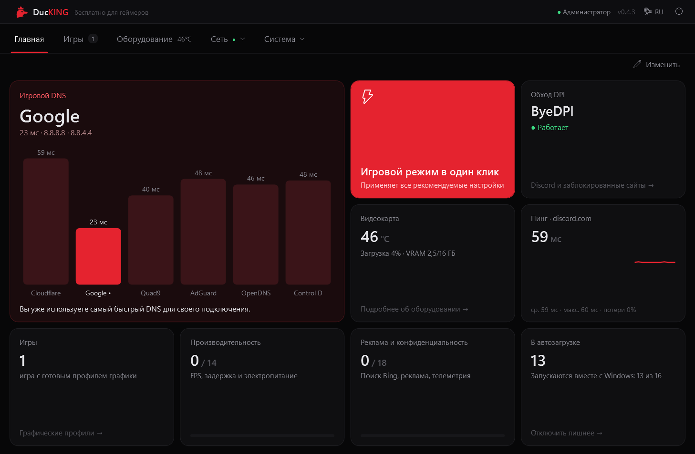
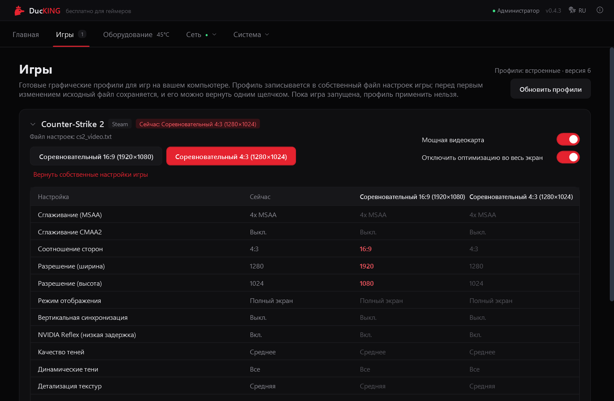
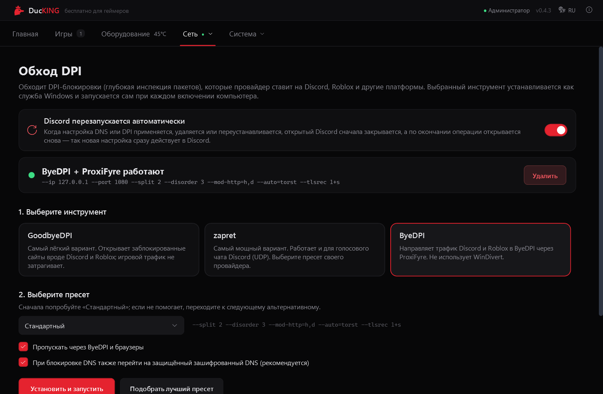
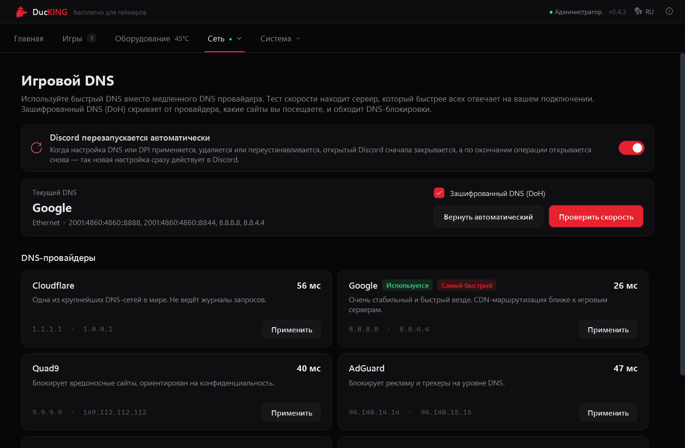
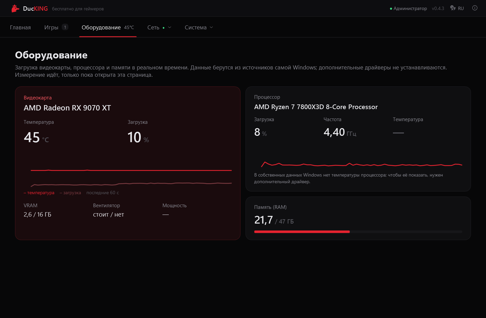
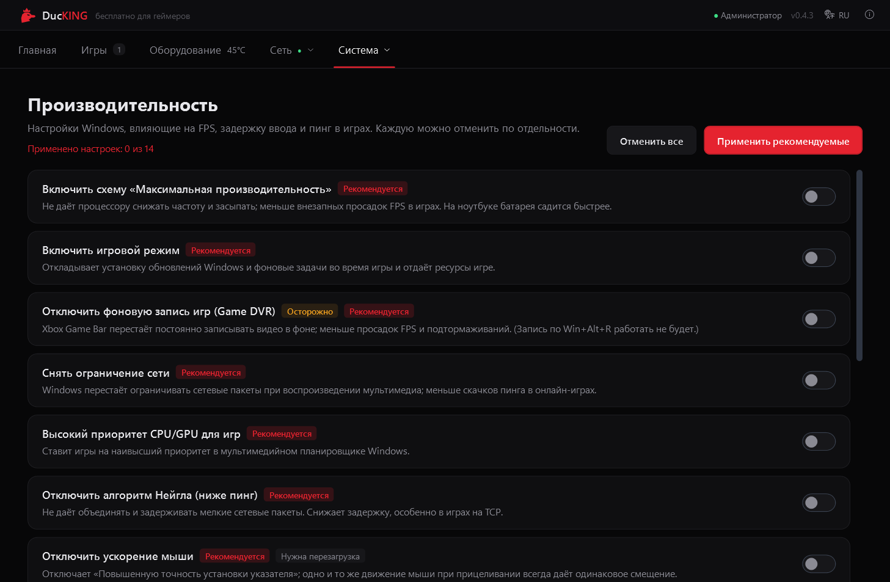

<p align="center">
  
</p>

<h1 align="center">DucKING</h1>

<p align="center">
  <b>Бесплатная программа с открытым исходным кодом для геймеров на Windows</b><br>
  Игровой DNS · обход DPI · отключение рекламы и телеметрии · оптимизация · графические профили для игр
</p>

<p align="center">
  <a href="https://github.com/uy4r/DucKING/releases/latest"></a>
  <a href="https://github.com/uy4r/DucKING/releases"></a>
  
  <a href="LICENSE"></a>
</p>

<p align="center">
  <a href="README.md">Türkçe</a> · <a href="README.en.md">English</a> · <b>Русский</b>
</p>

<p align="center">
  
</p>

DucKING собирает в одной программе то, что геймеру обычно приходится настраивать в Windows по
отдельности: находит самый быстрый DNS и включает его с шифрованием, обходит DPI-блокировки, которые
провайдеры ставят на Discord, YouTube, Roblox и другие платформы, отключает рекламу, поиск в интернете
и телеметрию Windows и применяет настройки, влияющие на FPS и задержку в играх. Любое изменение
отменяется одним щелчком.

Интерфейс на **турецком, английском и русском** языках. Язык выбирается при установке и потом
меняется в верхней панели программы.

## Скачать

**[Скачать последнюю версию](https://github.com/uy4r/DucKING/releases/latest)** → `DucKING-Setup-<версия>.exe`

1. Запустите установщик и выберите язык (Türkçe / English / Русский).
2. Файл не подписан, поэтому Windows SmartScreen может показать предупреждение:
   **Подробнее → Выполнить в любом случае**.
3. DucKING работает с правами администратора: они нужны для DNS, служб Windows и системных настроек.

**Требования:** 64-битная Windows 10 (1809 и новее) или Windows 11. Для зашифрованного DNS (DoH) нужна
Windows 11. Устанавливать .NET не нужно: программа поставляется со своей средой выполнения.

## Возможности

| | |
| --- | --- |
| **Главная** | Плитки, которые можно перемещать и менять размер (1×1, 2×1, 2×2): скорость DNS, состояние обхода DPI, пинг, температура видеокарты, игровой режим в один клик. |
| **Игровой DNS** | Измеряет 6 провайдеров (Cloudflare, Google, Quad9, AdGuard, OpenDNS, Control D) настоящими DNS-запросами, в один клик включает самый быстрый для вашего подключения и включает зашифрованный DNS (DoH) в Windows 11. Предупреждает, если DNS провайдера выдаёт для Discord поддельный адрес. |
| **Обход DPI** | Устанавливает GoodbyeDPI, zapret или ByeDPI (вместе с ProxiFyre) как службу Windows, которая запускается вместе с компьютером. Для zapret есть пресеты для России: общий, Ростелеком, Билайн, МГТС. **Подобрать лучший пресет** перебирает пресеты по очереди и устанавливает тот, при котором лучше всего открываются Discord, YouTube и Roblox. |
| **Игры** | Находит игры в библиотеках Steam, Epic и Riot и записывает готовые графические профили в собственный файл настроек игры, предварительно сохранив оригинал. По щелчку на карточке видна таблица всех настроек (сглаживание, тени, текстуры…) с текущим значением и значением профиля. |
| **Оборудование** | Температура, загрузка и видеопамять видеокарты, загрузка и частота процессора, память. Без дополнительных драйверов: данные берутся из самой Windows. |
| **Производительность** | Схема питания «Максимальная производительность», игровой режим, фоновая запись игр (Game DVR), ограничение сети, алгоритм Нейгла, ускорение мыши, HAGS и другое. |
| **Реклама и конфиденциальность** | Поиск Bing в меню «Пуск», реклама и рекомендации, Copilot, Recall, мини-приложения и телеметрия. |
| **Автозагрузка и приложения** | Отключает программы автозагрузки тем же способом, что и Диспетчер задач, и удаляет предустановленные приложения вроде Новостей, Clipchamp и Teams (приложения Xbox не затрагиваются). |
| **Перезапуск Discord** | При изменении настроек DNS или DPI открытый Discord закрывается и открывается снова, чтобы новая настройка сразу заработала. |

## Скриншоты

| Игры | Обход DPI |
| --- | --- |
|  |  |
| **Игровой DNS** | **Оборудование** |
|  |  |
| **Производительность** | |
|  | |

## Это безопасно?

- **Любую настройку можно отменить.** Исходное значение каждого изменённого параметра хранится в
  `C:\ProgramData\DucKING\backup.json` и восстанавливается, когда вы выключаете настройку. Перед
  игровым режимом в один клик можно создать точку восстановления системы.
- **Чистое удаление.** При удалении стираются службы обхода DPI, ProxiFyre и правило брандмауэра; по
  желанию все изменённые настройки возвращаются к прежним значениям.
- **Никакого сбора данных.** В DucKING нет телеметрии и аналитики. В сеть программа выходит только для
  теста скорости DNS, пинга до discord.com, проверки DNS-блокировки, проверки новой версии и файлов
  профилей на GitHub (только уведомляет и ничего не устанавливает сама) и проверки, открываются ли
  сайты, во время «Подобрать лучший пресет».
- **Предупреждения антивируса.** GoodbyeDPI и zapret используют драйвер WinDivert для обработки
  пакетов, и некоторые антивирусы ошибочно считают его угрозой. Все входящие в состав инструменты имеют
  открытый исходный код и перечислены ниже.

Если что-то пошло не так, **О программе → Создать отчёт диагностики** сохранит zip-архив на рабочий
стол (имя пользователя и имя компьютера скрываются). Его можно приложить к
[сообщению о проблеме](https://github.com/uy4r/DucKING/issues).

## Об обходе DPI

| Инструмент | Как работает | Когда использовать |
| --- | --- | --- |
| **GoodbyeDPI** | Разбивает исходящие пакеты с помощью WinDivert и перенаправляет DNS-запросы на безопасный сервер. | Самый лёгкий вариант, обычно его достаточно. |
| **zapret** | Отправляет поддельные пакеты через WinDivert; работает и для голосового чата Discord (UDP). | Выберите пресет для своего провайдера. |
| **ByeDPI** | Локальный SOCKS5-прокси; трафик Discord и Roblox направляется в него через ProxiFyre. Не использует WinDivert. | Системы, где WinDivert не работает или его блокирует антивирус. |

Одновременно работает только один инструмент. Некоторые провайдеры блокируют и на уровне DNS; если
DucKING это обнаружит, он предложит перейти на зашифрованный DNS. Эти инструменты предназначены для
обхода блокировок провайдера; соблюдение законов вашей страны остаётся на вашей ответственности.

## Игровые профили

Сейчас для **Counter-Strike 2** есть два профиля: *Соревновательный 16:9 (1920×1080)* и
*Соревновательный 4:3 (1280×1024)*. Список игр хранится в
[`src/DucKING/Profiles/games.json`](src/DucKING/Profiles/games.json) и редактируется только в этом
репозитории; пользователи не могут добавлять игры в программе. Когда `version` этого файла
увеличивается, DucKING получает новые профили с GitHub, не дожидаясь новой версии.

Чтобы предложить игру, откройте [issue](https://github.com/uy4r/DucKING/issues).

## Сборка из исходного кода

Нужны [.NET 8 SDK](https://dotnet.microsoft.com/download/dotnet/8.0) и
[Inno Setup 6](https://jrsoftware.org/isinfo.php) (`winget install JRSoftware.InnoSetup`).

```powershell
powershell -File build.ps1
```

Установщик создаётся в `artifacts\DucKING-Setup-<версия>.exe`. Номер версии берётся из `<Version>` в
`src/DucKING/DucKING.csproj`. Значок программы генерируется из `src/DucKING/Assets/ducking.svg`
скриптом `tools\make-icon.ps1`.

```
src/DucKING/
  Core/              Движок настроек, резервные копии, API служб, локализация (Loc, UiText)
  Modules/Dns/       DNS-провайдеры, тест скорости, DoH
  Modules/Dpi/       Установка GoodbyeDPI, zapret, ByeDPI + ProxiFyre и пресеты
  Modules/Games/     Поиск игр и графические профили
  Modules/Tweaks/    Настройки производительности и конфиденциальности
  Profiles/          games.json и dpi-presets.json (встроены в exe)
  Views/             Страницы
  Tools/             Входящие в состав инструменты обхода DPI
installer/           Скрипт Inno Setup
```

## Благодарности и лицензия

DucKING существует благодаря этим проектам с открытым исходным кодом:
[GoodbyeDPI](https://github.com/ValdikSS/GoodbyeDPI),
[zapret](https://github.com/bol-van/zapret),
[ByeDPI](https://github.com/hufrea/byedpi),
[WinDivert](https://github.com/basil00/WinDivert),
[ProxiFyre](https://github.com/wiresock/proxifyre) и
[Windows Packet Filter](https://github.com/wiresock/ndisapi).
Их лицензии и подробности: [THIRD_PARTY_NOTICES.md](THIRD_PARTY_NOTICES.md).

Собственный код DucKING распространяется по [лицензии Apache 2.0](LICENSE). Программа бесплатна и
такой останется.

Если вы распространяете проект, который использует или изменяет DucKING, лицензия требует сохранить
указание авторства DucKING из файла [NOTICE](NOTICE) (название проекта, автор и ссылка) и отметить
изменённые вами файлы.
